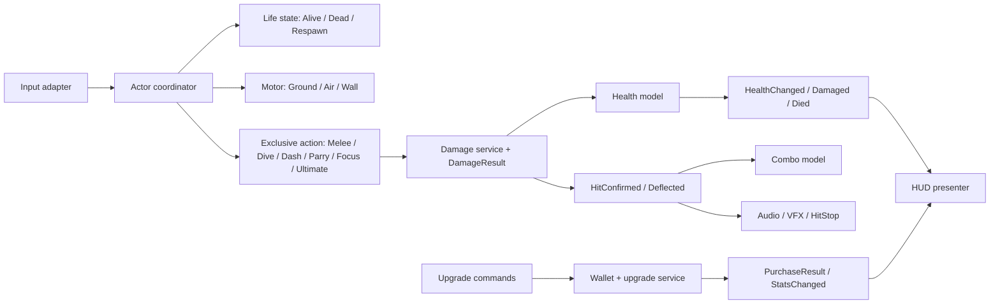

# Deep audit Samurai_Game2D — 14/10/2026

## Tiến độ sửa chữa — đợt 1–4, 14/10/2026

Các phát hiện/điểm số phía dưới lưu lại **trạng thái trước sửa**. Checklist này là trạng thái
triển khai mới nhất; không coi toàn bộ blueprint kiến trúc đã hoàn thành.

- [x] **A01:** melee kiểm tra vật cản Ground từ thân player tới closest point của collider mục tiêu.
  Mask riêng có thể cấu hình; mặc định bỏ qua PlatformEffector2D một chiều, không áp chính sách
  này lên AoE. Tường mỏng, không có tường, platform một chiều và nhiều collider đã qua test.
- [x] **A02:** dive giữ action khi pause, tiếp tục khi resume; lifecycle interruption vẫn hủy.
  Vận tốc và quét trên đường rơi chạy theo nhịp physics bằng WaitForFixedUpdate dùng lại.
- [x] **A03:** Mushroom giữ quyền sở hữu delayed effect; animation không hủy corpse trước vụ nổ.
  Prefab thật giữ telegraph, gây damage một lần sau 0,75 giây rồi hủy. Timeout dự phòng còn nguyên.
- [x] **A04:** cancel/reset/disable hủy Invoke phục hồi của dive cũ. Callback cũ không kết thúc melee mới.
  Đây là sửa lỗi callback cụ thể; chưa thay toàn bộ animation event bằng action generation.
- [x] **A05:** PlayerHealth giải phóng hurt lock/coroutine khi disable, kể cả disable riêng component;
  không xóa trạng thái chết hoặc tự hồi sinh nhân vật.
- [x] **A06:** mana kiểm tra finite ở initialization/add/set/max/spend, bão hòa cộng số lớn không overflow.
  NaN/Infinity bị từ chối, giá trị hợp lệ và tỷ lệ mana được giữ.
- [x] **A07:** coin magnet/commit và health pickup dùng guard vòng đời player; resolve qua parent.
  TryHeal báo kết quả trước consume, consumeIfFull vẫn có ngữ nghĩa riêng. Sword pickup dùng chung guard.
- [x] **A08:** bổ sung TryTakeDamage/TryDeflect trả kết quả, giữ wrapper void để tương thích callback cũ.
  Melee/dive/slam/fireball/sword chỉ ghi combo từ hit được chấp nhận; phản kiếm ghi một lần.
  Ultimate dùng kết quả trực tiếp, phản đạn không phát hit feedback khi damage bị từ chối.
  Chưa triển khai global DamageResult/HitConfirmed event pipeline; đó là bước kiến trúc tiếp theo.
- [x] **A09:** hook sceneLoaded/sceneUnloaded có reset static và chống đăng ký/lần sinh lặp;
  population theo từng scene, hỗ trợ cả CompositeCollider2D và TilemapCollider2D độc lập.
  Sample → LV6 đều sinh được bình; menu/ending không sinh.
- [x] **A10:** Sprite/Texture tự tạo được giải phóng bởi owner, không hủy tài nguyên được cung cấp.
  Bình có ID trong collectedPickups, chống thưởng lặp qua callback/checkpoint/Save/Continue;
  Play Again rollback cả reward và marker. Scene-save/build validator bao phủ ID bình đặt tay.
- [x] **A11 — phần query:** thay 5 OverlapCircleAll bằng List tái sử dụng, dùng lại HashSet;
  dive tick theo physics. List tăng khi cần, không cắt mất target do fixed-cap.
  Test 41 collider cùng mục tiêu chỉ gây damage/combo một lần. **Chưa benchmark CPU/GC**;
  không khẳng định zero allocation hoặc đã hoàn tất pooling/VFX optimization.
- [x] **A12:** archetype/ranged/ledge policy/HP/death explosion lấy từ cấu hình serialized,
  không suy ra hoặc ghi đè theo tên GameObject. Migration 8 prefab + 16 override HP,
  đối chiếu parity 87 quái đặt trong 6 màn; test rename trước/sau Awake và HP tùy chỉnh đạt.
- [x] **A13:** PlayerUpgradeService + UpgradePurchaseResult + scoped purchase access;
  PlayerStats không tham chiếu SamuraiModal/PlayerStatsUI/CheckpointShrineUI.
  Cả hai shop dùng chung command/result, event presenter có subscribe/unsubscribe theo lifecycle.
- [ ] **Kiến trúc/P3:** FSM/action generation toàn diện, event presenters, rename/namespace/asmdef/legacy cleanup.
  Lộ trình đã được duyệt; Đợt kiến trúc 0–1 (baseline, wallet và player/scene context)
  đã triển khai/qua runner riêng. Theo dõi từng đợt tại [ARCHITECTURE_CLEANUP.md](ARCHITECTURE_CLEANUP.md),
  không đánh dấu toàn bộ FSM/P3 đã hoàn thành.

### Kiểm chứng đợt sửa

- C# build: PASS, 0 warning / 0 error.
- Runner mới `DeepAuditRepairValidation.Run`: **PASS, 41 assertions, exit 0**.
  Log: `Logs/DeepAuditRepairValidation-2026-10-14.log` (local, không commit).
  Đây là regression mong hành vi đúng, không phải probe chỉ ghi nhận bug cũ.
- `CombatUpgradeValidation.Run`: **PASS, 29 assertions, exit 0**;
  log `Logs/CombatUpgradeValidation-2026-10-14.log`.
- `RepairValidation.Run`: **PASS, exit 0**, gồm save/assets, Phases 3–5,
  behavior 8 prefab địch, damage/pickups, player controls và LV5 → LV6 → Ending;
  log `Logs/RepairValidation-2026-10-14.log`.
- Tất cả Play Mode runners chạy trong bản sao cô lập với company/product/save riêng;
  không chạy batch Unity trên workspace đang mở, không thay scene layout/input/save schema.
- Cần test tay: góc tường/dốc, platform một chiều thực tế, cảm giác dive sau pause và hiệu ứng nấm.
  Headless assertions không chứng minh mọi cảm giác gameplay/render/audio đã hoàn hảo.

### Đợt 2 — breakable props và persistence

- `BreakableProp` sinh tối đa 4 vị trí/scene. Chỉ quét collider Ground, bỏ trigger/composite rỗng
  và collider đang hợp nhất vào composite khác. Kiểm tra mặt phẳng có hai chân đỡ, khoảng trống
  thân bình, khoảng cách checkpoint/spawn và chống trùng vị trí. Không thay dữ liệu Tilemap/scene.
- Map cũ dùng `LevelRespawnManager.CurrentCheckpoint` làm dấu hiệu gameplay/điểm cần tránh;
  map có `SceneSpawnPoint` cũng được hỗ trợ. Không suy ra gameplay từ substring tên scene.
- Slot tự sinh được định danh theo hierarchy địa hình/component/slot, sắp thứ tự cố định.
  Không dùng InstanceID, thứ tự FindObjects hoặc vị trí player (có thể khác khi Continue).
  Slot đã nhận thưởng vẫn chiếm giới hạn population; không sinh bình mới để bù vào chỗ đó.
- `pickupId` đặt tay được sửa ID thiếu/trùng khi lưu scene và bị từ chối khi build nếu chưa hợp lệ,
  dùng cùng validator của coin/sword. Bình thiếu ID không cấp phần thưởng không thể lưu.
- Chính sách: phá một lần trong tiến trình đang chơi; checkpoint giữ marker. Save/Continue giữ
  marker + vàng/mana; Play Again dùng snapshot đầu màn nên khôi phục cả bình và kinh tế tương ứng.
  Dùng danh sách `collectedPickups` có sẵn, giữ SaveData version 2; không reset/migrate save thật.
- Direct `Break()` và damage đều có guard alive/pause/transition/respawn. Marker + reward commit
  trước presentation/deferred destruction. RequireComponent là BoxCollider2D cụ thể.
  Hit flash có một owner, cleanup khi disable và không rung physical root/collider.
- Sprite tự sinh dùng sorting layer Items (trên terrain/background, dưới player); Sprite/Texture
  tạo riêng được giải phóng khi hủy owner. Sprite được gán từ ngoài không bị hủy.
- Phát hiện thêm trong regression Continue: lookup GameManager toàn cục có thể chọn root trùng
  đang chờ hủy ở scene activation. `PlayerSaveBridge` Capture/Apply nay resolve ví thuộc chính
  PersistentRoot của player. Test tạo root/ ví trùng xác nhận không ghi nhầm ví.
- Bản cuối `BreakablePropValidation.Run`: **PASS, 50 assertions, exit 0**;
  log `Logs/BreakablePropValidation-2026-10-14.log` (local, không commit).
  Chạy lại `DeepAuditRepairValidation` (**41 assertions**), `CombatUpgradeValidation`
  (**29 assertions**) và toàn bộ `RepairValidation`: **đều PASS, exit 0**,
  bao gồm save/checkpoint, 8 prefab địch và LV5 → LV6 → Ending. C# build **0 warning / 0 error**.
  Runners chạy trên bản sao cô lập với save riêng, không chạy batch trên workspace đang mở.

Giới hạn đợt 2: ID auto-v1 ổn định cho cùng hierarchy/component/slot của bản map hiện tại.
Đổi tên/cấu trúc địa hình ở bản phát hành sau cần migration ID hoặc chuyển sang điểm đặt tay
có ID serialized; không khẳng định ID tự sinh bất biến trước mọi chỉnh sửa level.
Save cũ chưa ghi ID bình thì không thể suy ra bình nào từng bị phá trước bản sửa này.
Cần chơi thử vị trí/cảm giác va chạm ở cả 6 màn; kiểm tra geometry headless không chứng minh
mọi chỗ đặt đều đẹp/dễ tiếp cận. Test ownership native assets không thay thế benchmark Profiler.

### Đợt 3 — A12, enemy configuration

- Giữ enum `GhostController.EnemyArchetype` và các giá trị serialized 0–3 hiện có.
  Bỏ toàn bộ `name.ToLower/Contains` trong GhostController và EnemyHealth1.
  `archetype`, `canShootRanged`, `avoidLedges` là nguồn dữ liệu trực tiếp từ prefab/scene.
  Boss/Skeleton vẫn bật ranged trong prefab; designer có thể tắt mà Awake/enrage không tự bật lại.
- Thêm `EnemyHealth1.explodesOnDeath` độc lập với archetype. Mushroom prefab bật cờ này;
  enemy khác mặc định tắt. Delayed effect vẫn giữ cleanup/animation ownership từ A03.
  Đổi tên hoặc vô tình chứa chữ mushroom không bật/tắt vụ nổ.
- Bỏ clamp HP theo tên. Baked **HP thực tế trước sửa**, không phải giữ các giá trị Inspector
  vốn bị code âm thầm ghi đè: Bat prefab 10 → 6, Mushroom 10 → 8, Golem 10 → 16.
  Có 16 override HP trong LV2–LV5 được đổi tương ứng (ví dụ Bat 30 → 6, Golem 15 → 16).
  Override hợp lệ còn lại giữ nguyên; sau sửa có thể đặt Bat/Mushroom HP > giới hạn cũ,
  Golem HP < 16 mà không bị code đổi lại. Không cân bằng lại độ khó trong đợt này.
- 8 prefab giữ nguyên MonoScript GUID, Animator/animation events, collider, attackPoint,
  transform, tốc độ, damage/cooldown và các cấu hình navigation đã có.
  Scene chỉ thay 16 giá trị HP override; không reserialize/bake lại layout hoặc Tilemap.
- Fixture `Assets/Editor/EnemyConfigurationBaseline.json` lưu 95 bản ghi **trước migration**:
  8 prefab và 87 prefab instances trong 6 màn, gồm effective HP/archetype/ranged/death capability.
  Runner dùng GlobalObjectId của prefab instance để đối chiếu đúng đối tượng,
  không chỉ đếm số quái hoặc tính lại expectation từ cấu hình đã sửa.
- `EnemyConfigurationValidation.Run`: **PASS, 235 assertions, exit 0**;
  gồm **197 asset-parity assertions + 38 Play Mode assertions**. Test dùng tên gây hiểu nhầm
  trước Awake, đổi tên runtime, HP tùy chỉnh, tắt ranged cả Boss/Skeleton, override ledge policy,
  nấm đã đổi tên nổ đúng một lần và Goblin mang tên mushroom không gây vụ nổ giả.
  Log: `Logs/EnemyConfigurationValidation-2026-10-14.log` (local, không commit).
- C# build **0 warning / 0 error**. Chạy lại `BreakablePropValidation` (**50 assertions**),
  `DeepAuditRepairValidation` (**41 assertions**), `CombatUpgradeValidation` (**29 assertions**)
  và toàn bộ `RepairValidation`: **đều PASS, exit 0**. Bao gồm behavior 8 prefab,
  save/checkpoint/Continue/PlayAgain, player controls và LV5 → LV6 → Ending.
  Tất cả runners chạy trên bản sao cô lập với company/product/save riêng.

Phạm vi A12: dùng enum/capability fields serialized hiện có và prefab làm cấu hình.
Chưa chuyển sang thư viện EnemyDefinition ScriptableObject, tách boss attack modules hoặc
thay FSM toàn diện; các bước đó vẫn nằm trong lộ trình kiến trúc, không đánh dấu hoàn thành.
Không đổi format save hoặc binding điều khiển. Playtest cảm giác/timing ở màn thật vẫn cần thiết.

### Đợt 4 — A13, purchase application service

- `PlayerStats` giữ nguyên field serialized, giá/step mặc định, MonoScript GUID và API
  `UpgradeHealth/Mana/Damage/Speed`, `Unlock* Talisman` để không gãy callback Unity/luồng save.
  Các hàm cũ ủy quyền cho `PlayerUpgradeService.TryPurchase`; UI không sở hữu luật kinh tế.
- `PlayerUpgrade` định danh command; `UpgradePurchaseResult` trả Success/Unavailable/
  InsufficientFunds/AlreadyOwned/InvalidConfiguration/MissingDependency/Busy cùng giá và số dư.
  Default result không bị hiểu nhầm là thành công. Kiểm tra alive/active/pause/transition/game over/
  respawn, module khả dụng, cost không âm và bước tăng hữu hạn/không overflow trước khi chi tiền.
  Giá 0 vẫn được hỗ trợ như cấu hình miễn phí chủ ý, không đổi giá hợp lệ đang có.
- Chỉ áp stat/ngọc sau khi `TrySpend` thành công; command bị từ chối không đổi dữ liệu/tiền/events.
  Giao dịch đồng bộ trên main thread, có guard chống gọi mua lồng trong observer. Event chỉ phát sau
  commit, subscriber lỗi không đảo ngược giao dịch hoặc cản subscriber tiếp theo.
  Đây không phải transaction database hay cơ chế rollback cho mọi exception native ngoài dự kiến.
- `UpgradePurchaseAccess.PauseSession` là quyền có owner/target/lifecycle, không kiểm tra tên kiểu UI.
  Shop mở bằng target PlayerStats rõ ràng; đóng/disable/đổi modal/chuyển màn thu hồi quyền.
  Không mang quyền cũ sang player khác; lease cũ Dispose không thu hồi lease thay thế.
  API này dành cho application callers tin cậy, không phải security boundary chống script gian lận.
- `SamuraiModal.AllowsPurchases` giữ compatibility cho pause UI nhưng nay đọc phiên mua generic,
  không còn `owner is PlayerStatsUI || owner is CheckpointShrineUI`. Guide/settings không cấp quyền.
- PlayerStats resolve ví của chính PersistentRoot, không rebind toàn cảnh mỗi scene vào root trùng.
  `StatsChanged`/`Purchased` là C# events scoped theo player; PlayerStatsUI bind snapshot + events,
  unsubscribe khi đóng/disable/destroy, mở lại không nhân listener. Shrine dùng command/result chung.
  UI chỉ phát âm thanh thành công khi thực sự mua được; callback bảng đã đóng không thể mua lén.
- `UpgradePurchaseValidation.Run`: **PASS, 78 assertions, exit 0**. Bao phủ 7 loại mua, đúng giá,
  tỷ lệ HP/mana, mua trùng, thiếu tiền, âm/0 cost, NaN/Infinity/overflow, module disabled,
  reentrant observer, scoped pause, wrong target, disable/re-enable, root/ví trùng,
  stats/guide/shrine/settings, subscription khi mở lại và Save/Quit/Continue thật.
  Log: `Logs/UpgradePurchaseValidation-2026-10-14.log` (local, không commit).
- C# build **0 warning / 0 error**. Chạy lại EnemyConfiguration (**235 assertions**),
  BreakableProp (**50**), DeepAuditRepair (**41**), CombatUpgrade (**29**) và toàn bộ
  RepairValidation: **đều PASS, exit 0**, gồm 8 prefab địch và LV5 → LV6 → Ending.
- `SamuraiUIValidation.Run` có graphics: **PASS, 19 assertions, exit 0**, chụp 7 ảnh
  stats/shrine/guide/HUD/pause ở 1280×720, 1920×1080 và 1024×768.
  Đã xem ảnh stats-1280: chỉ số/số dư/giá được cập nhật, bố cục hiện có giữ nguyên.
  Log `Logs/SamuraiUIValidation-2026-10-14.log`, ảnh `Logs/UI-2026-10-14/` (local).
  Tất cả 7 runners chạy trong bản sao cô lập với company/product/save riêng;
  không chạy batch Unity trên workspace đang mở hoặc ghi save thật.

Giới hạn: service/application vẫn dùng Unity lifecycle và wallet GameManager hiện có;
chưa tách toàn bộ economy thành model thuần C#, IWallet hay thay mọi HUD bằng event presenters.
StatsChanged observer invocation và mở lease có allocation nhỏ theo giao dịch/mở shop,
không khẳng định zero-allocation. Không đổi save version 2, key binding hoặc bố cục UI/map.
Phần đo Profiler A11, FSM/boss modules và naming/asmdef/legacy/P3 vẫn chưa hoàn thành.

## Phạm vi và bằng chứng

- Kiểm kê/quét 83 script runtime trong `Assets/Scrpits`, tổng 10.874 dòng ở thời điểm audit.
  Lần theo luồng Player, AI/Boss, combat, presentation, pickup, save, respawn, scene và UI;
  đối chiếu animation/prefab liên quan. Có 14 script Editor phục vụ xây map/validation;
  mã ví dụ TextMesh Pro và package Unity không được chấm như code game tự viết.
- Unity xác nhận từ ProjectVersion: 6000.0.49f1. Project C# sinh bởi Unity dùng LangVersion 9.0.
- Build solution hiện tại: PASS, 0 warning, 0 error. Build không chứng minh gameplay đúng.
- Chạy `DeepAuditProbe.Run` trong bản sao `.utmp/Phase3Validation-a48f5f4e209f4cc2ae0b841f76051956`.
  Company/product được đổi riêng, không đọc/ghi save thật. Probe không sửa mã runtime.
  Hash runtime giữa workspace và bản sao giống nhau, trừ một dòng trống cuối PlayerStatsUI.
- Log: `Logs/DeepAuditProbe-2026-10-14.log`, exit 0; 9 tình huống lỗi quan sát được.
  Đây là probe **xác nhận lỗi đang tồn tại**, exit 0 không có nghĩa các lỗi đã được sửa.
- Các log regression trước đó (UI, 29 combat assertions, toàn bộ RepairValidation) được tham khảo
  cho phạm vi đã bao phủ; không gọi đó là một lần chạy mới trong lượt audit này.
- Chưa đo CPU/GC bằng Profiler trên player build/thiết bị đích. Không suy ra FPS hay ms từ static scan.
- Lượt audit ban đầu chỉ thêm báo cáo; mã probe nằm trong bản sao cô lập. Các sửa chữa tiếp theo
  được ghi riêng trong checklist đầu tài liệu, không sửa lại bằng chứng lịch sử bên dưới.

## Bảng tổng hợp

| Mục | Điểm / 10 | Nhận định |
|---|---:|---|
| Stability | 6,5 | Save/chuyển màn có bảo vệ tốt; còn lỗi pause, death effect, callback và pickup đã tái hiện |
| Architecture | 6 | Có module và action guard, nhưng Gameplay phụ thuộc trực tiếp UI; AI/combat gánh nhiều nhiệm vụ |
| Cleanliness | 5,5 | Tên/field/comment chưa thống nhất, code legacy và chuỗi cấu hình phân tán |
| Performance | 6 | Có pool/cache hữu ích; dive còn query cấp phát mỗi frame, presentation vẫn tạo nhiều coroutine/chuỗi |

Điểm là đánh giá kỹ thuật cho trạng thái hiện tại, không phải kết quả benchmark.
P0: chưa tìm thấy bằng chứng đủ để kết luận lỗi nguy kịch/mất dữ liệu diện rộng.
P1: ảnh hưởng hành vi chiến đấu cốt lõi, ưu tiên trước mở rộng tính năng.
P2: lỗi có điều kiện, dữ liệu thiếu bảo vệ, hiệu năng/kiến trúc cần cải thiện.
P3: dọn dẹp, convention và tối ưu nhỏ.

## Phát hiện P1

### A01 — Melee gây sát thương qua tường Ground

- Vị trí: [PlayerCombat.cs](../Assets/Scripts/Player/PlayerCombat.cs), dòng 155–196; so với
  [GhostController.cs](../Assets/Scripts/Enemy/Controllers/GhostController.cs), `CanHit`/`HasLineOfSight`.
- `DoAttackDamage` chỉ OverlapCircle rồi gọi TakeDamage. Không kiểm tra địa hình giữa player và mục tiêu.
- Probe: đặt tường Ground mỏng giữa player và collider địch, phát đòn 1 bằng Animator thật;
  HP địch vẫn giảm. Đây là hành vi xác nhận được, không phải dự đoán từ tên hàm.
- Tác động: tính che chắn của tường không nhất quán giữa player, AI và ultimate.
- Fix: thêm chính sách occlusion theo attack, dùng contact/closest point và blocker mask riêng;
  chỉ ghi hit khi target nhìn thấy và chấp nhận damage. Kiểm tra cả tường mỏng, góc tường,
  sàn một chiều và địch có nhiều collider. Không mặc định áp cùng quy tắc lên mọi AoE.
- Mức P1 dựa trên yêu cầu melee tôn trọng vật cản. Nếu đánh xuyên tường là thiết kế có chủ ý,
  cần khai báo trong AttackDefinition và điều chỉnh mức ưu tiên, thay vì để thành hành vi ngầm.

### A02 — Pause hủy bổ đao trên không

- Vị trí: [PlayerCombat.cs](../Assets/Scripts/Player/PlayerCombat.cs), dòng 325–330;
  [PlayerController1.cs](../Assets/Scripts/Player/PlayerController1.cs), `CanAct`.
- Dive coroutine chạy tiếp qua `yield return null`; `CanAct` trả false khi timeScale = 0.
  Coroutine gọi CancelDive dù đây chỉ là pause. Dash/ultimate lại có cách xử lý khác.
- Probe: bắt đầu dive, chờ 0,16 giây rồi pause; IsDiving chuyển false trong khi pause.
- Fix: tách kiểm tra vòng đời (`CanContinueAction`) khỏi pause; giữ nguyên trạng thái khi pause,
  chỉ hủy khi chết, hurt, disable, respawn hoặc chuyển màn. Vận tốc/quét physics nên được tick tại FixedUpdate.

### A03 — Mushroom mất vụ nổ khi chết do hai chủ sở hữu destruction

- Vị trí: [EnemyHealth1.cs](../Assets/Scripts/Enemy/Controllers/EnemyHealth1.cs), dòng 138, 165, 202;
  [Mushroom/die.anim](../Assets/Animation/Mushroom/die.anim), dòng 82–83.
- Coroutine chờ 0,75 giây nhưng animation gọi DestroySelf ở 0,45 giây.
  GameObject bị hủy trước khi coroutine thực hiện sát thương/vụ nổ.
- Probe prefab Mushroom thật: object không còn ở 0,65 giây; player đứng trong bán kính không nhận damage.
- Fix: DeathSequence làm chủ việc hủy. Animation chỉ báo hoàn tất phần hình ảnh;
  Mushroom chỉ được release sau delayed effect. Giữ timeout dự phòng và hủy sequence khi unload scene.
  Không chỉ kéo dài một animation, vì như vậy logic lại tiếp tục phụ thuộc thời lượng clip.

## Phát hiện P2

| ID | Vị trí | Lỗi/rủi ro và điều kiện | Cách sửa |
|---|---|---|---|
| A04 | PlayerCombat.cs:452, 455, 268 | `Invoke(FinishAttack)` từ lần dive trước không bị hủy khi cancel/reset. Probe reset ngay sau land, bắt đầu melee mới: callback cũ kết thúc melee mới | CancelInvoke khi thoát/reset, hoặc dùng action generation/token để callback chỉ hoàn tất action đã tạo nó |
| A05 | PlayerHealth.cs:151; PlayerController 1.cs:181 | Tắt rồi bật GameObject trong HurtStun: coroutine bị dừng, cờ IsHurting còn true. Probe chờ hơn thời lượng stun vẫn không CanAct | Quy định rõ reset khi disable/re-enable, hoặc dùng deadline/state owner không phụ thuộc coroutine sống để gỡ cờ |
| A06 | PlayerMana.cs:28, 43, 54, 70 | Các setter/add/max thiếu kiểm tra finite. Probe SetCurrentMana(NaN) rồi TrySpend(1): Current vẫn NaN, TrySpend trả true | Kiểm tra hữu hạn ở mọi đầu vào và cả invariant Current/Max trước khi spend; đồng bộ với PlayerHealth |
| A07 | CoinPickup.cs:59, 65; HealthPickup.cs:15 | Coin không kiểm tra dead/transition trong điểm commit; HealthPickup tiêu thụ dù Heal bị từ chối. Probe player chết vẫn được coin; pickup khi pause biến mất mà HP không tăng | Gom validation tại Collect/TryCollect; resolve player qua parent; dùng kết quả TryHeal trước khi consume, định nghĩa riêng consumeIfFull |
| A08 | FireballController.cs:65, 86; PlayerCombat.cs:177–219; SwordProjectile.cs:77–85 | Có target trong query bị coi là hit thành công. Probe enemy health disabled: burst không giảm HP nhưng combo +1. Melee phản đạn còn có hai đường RecordHit: trong Deflect và cuối swing | Trả DamageResult/DeflectResult; phân biệt found/attempted/applied; chỉ một nơi ghi combo cho cùng sự kiện. Phần burst đã tái hiện; đường cộng đôi phản đạn xác định từ call graph |
| A09 | BreakableProp.cs:172–177 | AutoPopulate dùng RuntimeInitialize AfterSceneLoad như callback mỗi màn. Nó chỉ chạy ở scene đầu; nếu khởi động MenuScene thì return, vào map không tự chạy lại. Không thấy serialized BreakableProp trong scene/prefab | Scene-local spawner hoặc một service subscribe sceneLoaded; đặt điểm spawn có chủ đích và không phụ thuộc thứ tự bootstrap player |
| A10 | BreakableProp.cs:38, 88, 112, 167 | Tạo Sprite/Texture riêng nhưng không có chủ sở hữu giải phóng; phần thưởng cũng chưa có stable ID/persistence. Đây là rủi ro tài nguyên/reward khi bật spawn trên nhiều màn | Cache asset dùng chung hoặc Destroy asset do instance sở hữu; quyết định bình reset theo level hay đánh dấu thu thập, tránh farm qua save/reload. Chưa kết luận kích thước memory leak bằng Profiler |
| A11 | PlayerCombat.cs:155, 338, 414; GroundFireAOE.cs:33; FireballController.cs:65 | 5 vị trí OverlapCircleAll; nhánh dive chạy mỗi frame. HashSet/mảng được tạo lặp lại | Dùng buffer List/array tái sử dụng + HashSet.Clear; quét dive ở physics tick; đo GC Alloc trên build. List có thể vẫn cấp phát khi tăng capacity |
| A12 | GhostController.cs:94–102; EnemyHealth1.cs:33–36, 136 | Object.name quyết định archetype, ranged và clamp HP. Đổi tên object có thể đổi gameplay; hai class tự suy luận không cùng một config | EnemyDefinition/enum serialized; gán loại/HP/attack rõ trên prefab, giữ giá trị hiện tại khi migrate |
| A13 | PlayerStats.cs:65,145; SamuraiUI.cs:113 | Gameplay biết các kiểu UI cụ thể qua AllowsPurchases. Chu trình PlayerStatsUI → PlayerStats → SamuraiModal → PlayerStatsUI; khó kiểm thử model độc lập | Gameplay nhận context/policy mua hàng từ application service; UI chỉ gửi command và theo dõi kết quả/events |

A04/A05 là lỗi vòng đời có điều kiện, không khẳng định hiện xảy ra ở mọi lần chuyển màn.
A07 gọi callback trực tiếp trong probe để kiểm tra guard; timeScale = 0 thường ngừng physics,
nhưng điều đó không thay thế validation tại commit. Nhánh magnet coin khi player chết vẫn chạy
trong Update bình thường vì timeScale > 0 và không kiểm tra IsDead.

## Những phần đã tốt và các kết luận không nên đưa ra sai

- HitStop hiện dùng deadline, mở rộng lần dừng đang hoạt động, chỉ restore khi còn sở hữu mức slowdown.
  Modal hủy HitStop trước khi lưu timeScale. Không còn bằng chứng cho lỗi HitStop tự bật lại menu pause trước đây.
- SceneTransition giữ lock xuyên fade/load, đóng modal, đóng băng player body và phục hồi input/physics.
  Nó là coroutine main thread; những lỗi tìm thấy chủ yếu là thứ tự callback/vòng đời, không phải data race đa luồng.
- SaveSystem validate, ghi temporary file rồi replace, giữ backup và migration. Không thấy căn cứ gọi save hiện tại
  là mất dữ liệu diện rộng. Load có thể ghi lại file khi migrate: read API không hoàn toàn thuần.
- PersistentRoot, RunSession, PlayerLives có kiểm tra duplicate và xóa static reference khi owner bị hủy.
  GameManager không tự là DDOL singleton; nó được giữ bởi root. Không nên gán lỗi duplicate chỉ vì thấy static Instance.
- EnemyAI tồn tại nhưng không thấy GUID được gắn trong scene/prefab. Những vấn đề SetBool/SetTrigger cùng tên,
  patrol helper không cleanup và MovePosition trong Update là nợ legacy, chưa phải AI đang điều khiển 8 prefab chính.
- UIToggleHotkey còn trong Canvas/PersistentRoot nhưng panel hiện null. Không kết luận hiện có double-toggle P;
  nếu gán lại panel mà không migrate thì nó sẽ bỏ qua modal ownership.
- PlayerMovement cache PlayerJump; GhostController dùng List/hit buffer, Parry và Ultimate tái sử dụng collection.
  Không đúng khi nói mọi query hoặc mọi GetComponent hiện đều cấp phát mỗi frame.
- Cả `new ContactFilter2D` lẫn `new Vector2/Color/Rect` là value type; không mặc định tính là heap GC.
  LINQ FirstOrDefault ở SpawnLocator chạy lúc spawn/load, không phải hot Update.
- Quét không thấy Rigidbody2D.velocity cũ trong runtime. `ParticleNode.velocity` là field tự định nghĩa,
  không phải API vật lý deprecated. Runtime chủ yếu đã dùng linearVelocity phù hợp Unity 6.
- VFX pool có cap 256, prewarm 48 và cleanup; GhostTrail owns material; SoundManager owns clip tự sinh.
  Không nên báo lại những lỗi tài nguyên đã được sửa ở các module này.
- GUIStyle/Font đã cache ở shared theme; không có bằng chứng mọi OnGUI tạo font/style mới mỗi frame.
  Tuy nhiên chuỗi cooldown/số HP/combo vẫn tạo string qua nhiều GUI events.

## Performance và memory cần đo thêm

1. Dive và nhiều GroundFire đồng thời: GC Alloc/frame, số physics queries/tick và CPU self time.
2. VFX: coroutine/particle, tìm phần tử rảnh tuyến tính tối đa 256; pool cap không làm mọi chi phí biến mất.
   Cân nhắc ParticleSystem hoặc updater tập trung sau khi có số liệu.
3. Dust/projectile/floating damage text: vẫn Instantiate/Destroy. Pool riêng theo loại sau khi định nghĩa
   OnSpawn/OnDespawn/reset state; không đưa object có Invoke/coroutine chưa cleanup vào pool.
4. SoundManager EnsureInstance tạo/load/synthesize clips đồng bộ ở lần phát đầu. Warm-up khi loading;
   không gọi coroutine là giải pháp chuyển CPU sang thread khác. Voice pool có giới hạn nhưng chưa ưu tiên âm parry/warning.
5. Shrine tìm toàn cảnh mỗi giây; boss/vignette retry mỗi 0,5 giây. Có throttle, không phải mỗi frame,
   nhưng PlayerRegistry/SceneContext sẽ giảm lookup trên menu/scene không có player.
6. Các log damage/mana/score tạo string trong bản release. Dùng conditional logger hoặc development flag.
7. EpicBossHealthBar vẫn tạo 7 texture màu không dùng trong renderer mới; LevelBanner còn texture trang trí không dùng.
   Đây là P3: nhỏ và đã có destroy, không gán mức nghiêm trọng như native leak không giới hạn.

## Naming / code smells

| Hiện tại | Đề xuất | Ưu tiên / điều kiện |
|---|---|---|
| Assets/Scrpits | Assets/Scripts | P3; rename cùng .meta, không tạo GUID mới |
| PlayerController 1.cs / PlayerController1 | PlayerController.cs / PlayerController | P3; đổi file/class có kế hoạch, kiểm tra MonoScript.GetClass và prefab GUID |
| EnemyHealth1 / GhostController dùng cho nhiều loại | EnemyHealth / EnemyController | P3; giữ MonoScript GUID, wrapper nếu có call string, MovedFrom khi cần migration type |
| ThanhMau / ThanhMana / capNhatMau / UpdatScore | PlayerHealthView / PlayerManaView / SetValue / UpdateScore | P3; kiểm tra UnityEvent, giữ wrapper cho callback serialized |
| private field nhiều kiểu: _health, rb, currentHealth | Một convention `_camelCase`; PascalCase public API | P3; field serialized đổi kèm FormerlySerializedAs |
| MenuScene, Player, tên Animator, KeyCode rải rác | SceneCatalog, InputActions/InputBindings, cached Animator IDs | P2 nếu ảnh hưởng binding; các scene hiện có CanLoad validation, không phải mọi string đều thiếu kiểm tra |
| EnemyAI / AutoSaveTester trong production | Tách legacy/debug, bỏ sau kiểm tra refs | P3; AutoSaveTester thực sự gắn trên Player prefab; không xóa trước khi xác định F5 còn được dùng |
| Comment “tạo file mới”, “chỉ bổ sung”, ADDED/NEW kéo dài | Comment về invariant/ownership/ý đồ | P3; giảm nhiễu khi review |

Không ưu tiên đổi tên trước các lỗi P1. Tên sai chính tả không tự gây lỗi runtime;
rename vội làm mất GUID/callback mới có thể làm gãy prefab và animation.

## Kiến trúc đề xuất



- FSM gồm life, locomotion và một action owner; không tạo một enum khổng lồ cho mọi tổ hợp đứng/nhảy/chém.
  Mỗi action có Enter/Tick/FixedTick/Exit/Cancel và generation để callback cũ không hoàn tất action mới.
- Boss dùng EnemySensor/Motor + state Patrol/Chase/Telegraph/Attack/Recover/Stunned/Dead;
  PhaseController và AttackDefinition chọn melee/ranged/shadow dash. Boss1Controller wrapper có thể giữ khi migrate.
- EnemyDefinition/AttackDefinition là ScriptableObject cấu hình bất biến; HP, cooldown còn lại, stun,
  target và flags phải nằm ở runtime instance, không ghi trạng thái vào asset dùng chung.
- Health dùng chung logic nhận damage; boss chỉ thêm phase/presentation. Hợp nhất từ từ để giữ prefab GUID.
- C# event scoped theo actor/session là lựa chọn mặc định. UI subscribe/unsubscribe theo lifecycle,
  nhận snapshot khi bind. ScriptableObject event channel chỉ dùng cho tín hiệu thật sự xuyên scene;
  tránh thay coupling trực tiếp bằng một global event bus khó lần trace.
- Save adapter chụp model, scene flow làm chủ load/respawn; UI không làm chủ kinh tế hoặc luật combat.

## Ví dụ Before / After — minh họa, chưa áp dụng vào source

### 1. Dive: phân biệt pause và interruption

Before, trong vòng lặp dive:

```csharp
if (!controller || !controller.CanAct)
{
    CancelDive();
    yield break;
}
```

After, trong cùng vòng lặp:

```csharp
if (!controller || !controller.CanContinueAction)
{
    CancelDive();
    yield break;
}
if (Time.timeScale <= 0f)
{
    yield return null;
    continue; // Giữ action; không quét damage hay thay vận tốc khi pause.
}
```

Đồng thời Cancel/Reset phải hủy callback pending:

```csharp
CancelInvoke(nameof(FinishAttack));
```

Đây là sửa nhỏ trước mắt; action generation vẫn cần cho callback/event phát muộn của action trước.

### 2. Mushroom: DeathSequence làm chủ thời điểm hủy

Before: animation gọi DestroySelf ở 0,45 giây, còn coroutine chờ 0,75 giây.

```csharp
StartCoroutine(MushroomDeathExplosion());
// Animation event:
public void DestroySelf() => Destroy(gameObject);
```

After — ý tưởng tích hợp, giữ phần cleanup UI và VFX hiện có:

```csharp
private bool deathEffectPending;

private void BeginMushroomDeath()
{
    deathEffectPending = true;
    StartCoroutine(MushroomDeathExplosion());
}

public void DestroySelf()
{
    if (deathEffectPending) return;
    // Giữ cleanup healthBarInstance của project tại đây.
    Destroy(gameObject);
}

private IEnumerator MushroomDeathExplosion()
{
    yield return new WaitForSeconds(0.75f);
    // Chạy VFX và áp damage hợp lệ hiện có tại đây.
    deathEffectPending = false;
    DestroySelf();
}
```

Trong bản refactor hoàn chỉnh, effect có thể là object độc lập với corpse để animation/culling
không ảnh hưởng damage. Scene unload phải hủy effect; timeout không thay thế logic hoàn tất.

## Lộ trình an toàn, tiêu chí hoàn tất

| Bước | Công việc | Điều kiện để chuyển bước |
|---|---|---|
| 1 | Sửa A01–A03; chuyển probe tương ứng thành regression test mong hành vi đúng | Pause/resume dive giữ action; melee có occlusion policy; Mushroom nổ đúng một lần |
| 2 | Sửa callback generation, hurt lifecycle, finite mana và pickup commit | Reset/disable không để lock; NaN bị từ chối; pickup chỉ commit theo kết quả hợp lệ |
| 3 | DamageResult + HitConfirmed, Wallet/UpgradeResult | Combo không ghi hit bị từ chối; chi tiền và nâng cấp là một giao dịch; parity với save hiện có |
| 4 | FSM action/life, EnemyDefinition và boss attack modules | Di chuyển từng action/archetype; so sánh behavior 8 prefab, không thay đồng loạt Animator/prefab |
| 5 | Pool/query buffers và UI presenter events theo số đo | Đo Profiler trước/sau cùng cảnh, cùng mật độ địch/VFX; tránh mất collider khi buffer đầy |
| 6 | Rename, namespace, asmdef, bỏ legacy/debug sau kiểm tra refs | GUID/callback/save compatibility giữ; scene sweep không missing scripts |

Giữ `SaveData` version 2 nếu không thay schema. Nếu thay schema, thêm migration và fixtures;
không dùng refactor kiến trúc như lý do reset save người chơi. Sau mỗi bước chạy build và các
luồng checkpoint, Save/Quit/Continue, PlayAgain, LV5→LV6→Ending.

## Nguồn Unity kiểm chứng semantics

- Coroutine dừng khi GameObject inactive; `enabled=false` riêng MonoBehaviour không tự dừng coroutine:
  [Unity 6 Coroutines](https://docs.unity3d.com/6000.0/Documentation/Manual/Coroutines.html).
- AfterSceneLoad trong RuntimeInitializeLoadType là scene đầu, không phải mọi lần load:
  [RuntimeInitializeLoadType](https://docs.unity3d.com/6000.0/Documentation/ScriptReference/RuntimeInitializeLoadType.html).
- OverlapCircleAll cấp phát mảng kết quả:
  [Physics2D.OverlapCircleAll](https://docs.unity3d.com/6000.0/Documentation/ScriptReference/Physics2D.OverlapCircleAll.html).

Các nhận định riêng về project dựa trên source/prefab/animation và log probe ở trên, không lấy
documentation làm bằng chứng rằng một bug cụ thể đã tái hiện trong game.
